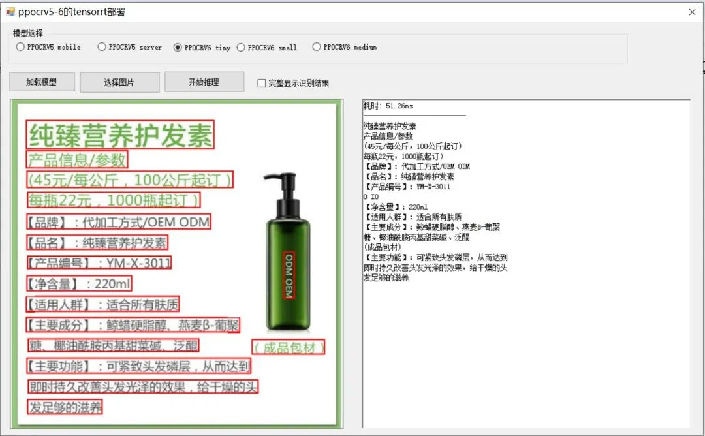

# Implementation of Winform PP-OCRv5/v6 TensorRT inference deployment based on C#

### I. Project Overview

This is a Windows Forms-based optical character recognition (OCR) desktop application that integrates the  PaddleOCR PP-OCRv5 and PP-OCRv6 series models, using the **TensorRT** inference engine for high-performance acceleration on NVIDIA GPUs. The project supports various model specifications (mobile, server, tiny, small, medium), and provides visual results display.



Insert image description here.

### II. Algorithm Principles

The OCR three-stage pipeline architecture is adopted:

```
Input image → [Text Detection] → [Direction Classification (optional)] → [Text Recognition] → Output results
```

2.1 Text Detection (Detection)

The algorithm DB (Differentiable Binarization) is used to detect text regions in images based on segmentation, outputting a polygonal frame with four points (x1,y1 ~ x4,y4). Main parameters:


Parameters


Note


Default value


`det_db_thresh`

Binary threshold


0.3

`det_db_box_thresh`

Box confidence threshold


0.6

`det_db_unclip_ratio`

Text box swell ratio


1.6

`limit_side_len`

Image pixel limit (long side)


960


2.2 Direction classification (Optional)

Perform direction judgment (0° / 180°) on detected text areas for correcting reversed text, with a classification threshold of `cls_thresh = 0.9`, which can be enabled or disabled in the UI.

2.3 Text Recognition

The architecture employs **CRNN (Convolutional Recurrent Neural Network) + CTC Loss**, converting cropped text region images (uniformly scaled to 48×320 pixels) into character sequences for output.

2.4 Reasoning Acceleration

All models are converted to the TensorRT FP16 precision engine (`.engine` file), which significantly improves inference speed compared to ONNX Runtime while maintaining high recognition accuracy.

#### 2.5 Supported Model Specifications


Model version


Model Name


Applicable scenarios


PP-OCRv5 mobile


Lightweight mobile model


Speed priority, general scenarios


PP-OCRv5 server


Server-side large model


Precision first, complex scenarios


PP-OCRv6 tiny


Lightweight model


Rapid reasoning


PP-OCRv6 small


Lightweight model


Balance between speed and precision


PP-OCRv6 medium


Medium-scale model


Higher precision requirements


### III. Environmental Requirements


Project


Requirements


Operating system


Windows 10/11 (64-bit)


Development tools


Visual Studio 2019 and above


.NET Framework


.NET Framework 4.8


Target platform


x64 (mandatory)


CUDA version


12.9 (mandatory)


cuDNN version


9.10.2 (mandatory)


TensorRT version


10.16.1.11 (mandatory)


GPU requirements


NVIDIA RTX 20 series and above (RTX 20/30/40/50 all supported)


Graphics card driver


NVIDIA driver that supports CUDA 12.9 (mandatory)


### 4. Installation Steps

4.1 Cloning or Downloading Projects

```
git clone firc-projects
# or directly download and unzip.
```

4.2 Open the solution using Visual Studio

Open the `FIRC.sln` file in the root directory using Visual Studio.

4.3 Configure the build platform

Set the solution platform to **x64** (required) in Visual Studio, and select either `Debug` or `Release` (needs to copy all files under the Debug directory beforehand).

4.4 Confirm Dependency Libraries

The project depends on the following DLL files, which must be present in the `bin\x64\Debug\` directory:

-

• `TensorRT.PPOCRSharp.dll` - Core OCR inference encapsulation library

-

• `OpenCvSharp.dll` - Image Processing Library

-

• `opencv_world481.dll` - OpenCV native library

-

• Newtonsoft.Json.dll - JSON serialization library

-

• CUDA/cuDNN/TensorRT related DLLs (cudart64_12.dll, cudnn64_9.dll, nvinfer_10.dll, etc.)

4.5 Convert TensorRT engine files

The project is accompanied by pre-compiled PP-OCRv6 tiny engine files. If you need to use other models, you need to execute the conversion command in the directory containing `trtexec.exe`.

```
# Example: Convert PP-OCRv6 small detection model
trtexec --onnx="inference\PP-OCRv6_small_det.onnx" --saveEngine="inference_trt\PP-OCRv6_small_det_fp16.engine" --fp16 --minShapes=x:1x3x32x32 --optShapes=x:1x3x960x960 --maxShapes=x:1x3x960x960
# Example: Convert PP-OCRv6 small recognition model
trtexec --onnx="inference\PP-OCRv6_small_rec.onnx" --saveEngine="inference_trt\PP-OCRv6_small_rec_fp16.engine" --fp16 --minShapes=x:1x3x48x32 --optShapes=x:4x3x48x320 --maxShapes=x:16x3x48x1280
```

### 5. Operating Steps

5.1 Launching the program

Run in Visual Studio by pressing F5, or directly start by double-clicking the compiled output `FIRC.exe`.

5.2 Selecting the Model

Select the target model in the "Model Selection" group box at the top of the main interface:

-

• PP-OCRv5 mobile / server

-

• PP-OCRv6 tiny / small / medium

5.3 Loading the Model

Click the "Load Model" button, wait for the model initialization to complete, and the text box will prompt "Model Load Success!".

#### 5.4 Selecting Images

Click the "Select Image" button to select the image to be recognized from the file dialog box (supports bmp, jpg, jpeg, tiff, tif, png format). The program defaultly loads `3.jpg` in the default loading directory when it starts.

5.5 Execute the inference

Click the "Start Reasoning" button to initiate the OCR recognition process using the TensorRT engine.

-

• Left-side image area displays the original image and uses **red polygons** to mark detected text areas.

-

• The right text box displays the recognition results and time consumption.

-

• Check the "Fully Display Result" checkbox to display the full JSON format result, which includes coordinates and confidence.

5.6 Release the model

When closing the program, the model resources will be automatically released; you can also re-click the "Load Model" button when switching models (the internal system will release and then load it).

### VI. Notes

1.

1. **Must use x64 platform**: The native DLLs used by the project are all 64-bit, and the build platform must be set to x64, not AnyCPU or x86.

1.

2. **GPU Driver Requirements**: Ensure that the NVIDIA graphics card driver version supports CUDA 12.9, and it is recommended to use the latest stable version of the driver.

1.

3. **Engine File Binding to Hardware**: The TensorRT `.engine` file is strongly bound to the GPU model, driver version, CUDA version, and TensorRT version it was generated from, making it **non-reusable across machines**. After switching machines or upgrading drivers, a reconversion is required.

1.

4. **The directory structure cannot be modified arbitrarily**: The directory structures and file names in `inference/` (ONNX model) and `inference_trt/` (TensorRT engine) must remain unchanged, and the program loads the model through a fixed path.

1.

5. **Initial inference slowness**: The TensorRT engine may have a warm-up overhead when performing the first inference, and subsequent inference speeds tend to stabilize. If inference times are unstable, refer to relevant blogs for guidance.

1.

6. **Direction Classification Model Optional**: If the cls engine file does not exist, the direction classification function will be automatically disabled, which will not affect the normal operation of detection and recognition.

1.

7. **Memory Release**: The program will automatically call `destroy` when closing to release GPU resources. Do not forcefully terminate the process to avoid causing memory leakage.

1.

8. **Recommended Image Size**: The program will resize the image to a maximum width of 960 pixels before detection. For very large images, it is recommended to pre-crop or reduce the size in advance to enhance efficiency.

### VII. Folder Structure Introduction

```
FIRC/
├── FIRC.sln                    # Visual Studio Solution file
├── FIRC.csproj  # Project configuration file (.NET Framework 4.8, x64)
├── Form1.cs  # Main form logic (model loading/inference/resource release)
├── Form1.Designer.cs  # Main form UI component definition
├── Form1.resx  # Form1 resource file for the form
├── OCRResult.cs  # OCR recognition result data model (text, score, four-point coordinates)
├── Program.cs  # Program entry point
├── App.config  # Application configuration file
├── README.txt  # Test environment description and trtexec conversion command examples
├── Properties/               # Project properties (programmatic information, resource configurations, etc.)
├── imgs/                       # Example test image
├── bin/x64/Debug/
├── FIRC.exe # Compiled and output executable file
│   ├── FIRC.exe.config
├── FIRC.pdb # Debugging symbol file
├── TensorRT.PPOCRSharp.dll # OCR inference encapsulation core DLL
├── OpenCvSharp.dll  # OpenCvSharp managed wrapper DLL
├── opencv_world481.dll # OpenCV C++ native library
├── Newtonsoft.Json.dll  # JSON serialization library
│   ├── cuda*.dll / cudnn*.dll / nvinfer*.dll Waiting  # CUDA/cuDNN/TensorRT Runtime library
│   ├── dll/x64/
├── OpenCvSharpExtern.dll # OpenCvSharp P/Invoke native bridge DLL
│   │   └── opencv_videoio_ffmpeg480_64.dll
├── inference/  # ONNX original model file and dictionary files
│   │   ├── PP-OCRv5_mobile_det_onnx.onnx
│   │   ├── PP-OCRv5_mobile_rec_onnx.onnx
│   │   ├── PP-OCRv5_mobile_cls_onnx.onnx
│   │   ├── PP-OCRv5_server_det_infer.onnx
│   │   ├── PP-OCRv5_server_rec_infer.onnx
│   │   ├── PP-OCRv6_tiny_det.onnx
│   │   ├── PP-OCRv6_tiny_rec.onnx
│   │   ├── PP-OCRv6_tiny_rec_dict.txt
│   │   ├── PP-OCRv6_small_det.onnx
│   │   ├── PP-OCRv6_small_rec.onnx
│   │   ├── PP-OCRv6_small_rec_dict.txt
│   │   ├── PP-OCRv6_medium_det.onnx
│   │   ├── PP-OCRv6_medium_rec.onnx
│   │   ├── PP-OCRv6_medium_rec_dict.txt
│   │   └── ppocrv5_dict.txt
├── inference_trt/ # TensorRT FP16 engine file (generated by trtexec)
│   │   ├── PP-OCRv6_tiny_det_fp16.engine
│   │   └── PP-OCRv6_tiny_rec_fp16.engine
├── trtexec.exe # TensorRT model conversion tool
└── trtexec_convert_commands.txt # Automatically generated conversion command reference file
└── .vs/ # Visual Studio user configuration (no version control)
```


## Payment

Here is a pay link on Stripe ( https://buy.stripe.com/3cs8yP7sY87d0vu9AB ). Please contact me lonlonago@foxmail.com after funding $89, and I will send you a complete data files , thank you!


